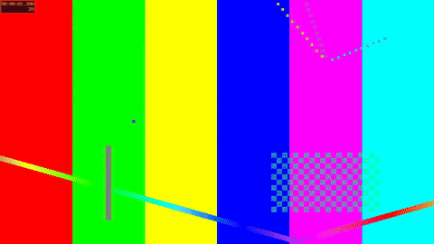

# digital-wipe-transition

A Claude Code / agent skill that creates **whip-pan wipe transitions** between two clips with plain ffmpeg. The cut is hidden in a streak of directional motion blur, the way you would get it by sweeping a camera in slow-shutter mode, but done in post.



The demo uses synthetic clips so the repo ships no third-party footage. Rebuild it with `examples/make_examples.sh`.

## Install as a skill

```bash
git clone https://github.com/ludodelot/digital-wipe-transition ~/.claude/skills/digital-wipe-transition
```

Then ask your agent for "a wipe transition between these two clips". It reads [SKILL.md](SKILL.md).

## Use the script directly

```bash
python3 scripts/wipe.py a.mp4 b.mp4 out.mp4 --duration 0.5 --direction left
```

Needs `ffmpeg` and Python 3.8+. No pip packages. See [SKILL.md](SKILL.md) for every flag.

## How it works

For `n` frames on each side of the cut, the script builds one ffmpeg filter graph: clip A's last `n` frames get a growing horizontal `gblur`, a scroll, a small exposure lift and RGB split; clip B's first `n` frames get the same treatment in reverse. Frames are placed by absolute timestamp and merged with `interleave`, so the output is exactly `len(A) + len(B)` frames.

MIT licensed.
